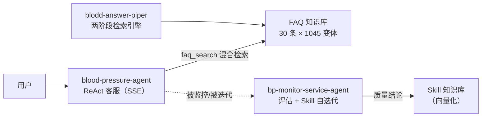

# 血压计 AI 客服平台（bp-ai-platform）

> 面向医疗器械（血压计）客服场景的 AI 平台：**语义检索引擎 + ReAct 客服 Agent + 技能自进化监控**三服务闭环，按企业级工程规范建设（CI 门禁 / 可观测 / 限流 / 医疗合规）。

[](https://github.com/zhou06080120/bp-monitor-service-agent/actions/workflows/ci.yml)
[](https://github.com/zhou06080120/blood-pressure-agent/actions/workflows/ci.yml)
[](https://github.com/zhou06080120/blodd-answer-piper/actions/workflows/ci.yml)
[](LICENSE)

## 项目总览

三个独立微服务，各仓库独立开发、独立 CI，本仓库提供**统一架构文档、一键编排（docker-compose）与平台级总览**：

| 仓库 | 角色 | 核心技术 |
|---|---|---|
| [blood-pressure-agent](https://github.com/zhou06080120/blood-pressure-agent) | **面向用户的客服 Agent**（SSE 流式） | 手写 ReAct 与 Function Calling 双实现、5 异构工具、语义缓存、决策状态机护栏 |
| [blodd-answer-piper](https://github.com/zhou06080120/blodd-answer-piper) | **FAQ 语义检索引擎** | Dense(BGE)+BM25 双路召回 → RRF 融合 → CrossEncoder 精排，ONNX INT8 量化推理 |
| [bp-monitor-service-agent](https://github.com/zhou06080120/bp-monitor-service-agent) | **技能自进化监控 Agent** | LLM-as-a-Judge + 语义嵌入双模态评估、Skill 向量检索动态挂载、异步任务解耦 + SSE 进度流 |



完整架构（数据流、部署拓扑、合规设计）见 **[docs/architecture.md](docs/architecture.md)**。

## 核心量化指标

| 指标 | 实测值 | 来源 |
|---|---|---|
| 混合检索命中率（216 查询 × 1075 候选） | Top1 **94.91%** / Top3 **98.61%** | blodd-answer-piper |
| ONNX INT8 量化推理延迟（p50） | 34.7ms → **16.5ms**（2.28× 加速） | blodd-answer-piper |
| CI 检索门禁（34 题黄金集） | Top1 94.1% / Top3 **100%** | blood-pressure-agent |
| 评估器判别力门禁（12 对金标） | 好答放行 / 坏答拦截双 **100%** | bp-monitor-service-agent |
| 单元测试 | 三仓合计 **394** 用例（79 + 217 + 98），CI 双版本矩阵全绿 | 三仓 CI |

## 工程化建设（P0 → P3）

| 阶段 | 内容 | 状态 |
|---|---|---|
| P0 工程化基座 | pyproject 标准化、单元测试、多阶段 Dockerfile、CI 流水线、README | ✅ |
| P1 生产加固 | 按 IP 滑动窗口限流、LLM SDK 显式重试、Worker 优雅关停、SSE 错误降级 | ✅ |
| P2 可观测与门禁 | JSON 结构化日志 + request_id、Prometheus /metrics、LLM 调用埋点、CI 评估门禁（eval-gate） | ✅ |
| P3 医疗合规 | 统一免责声明、输入校验、Prompt 注入拦截、密钥环境变量管理、平台总览仓库 | ✅ |

三仓共享同款基建模块（`rate_limit.py` / `observability.py` / `compliance.py` / `evals/gate.py`），CI 均为 **lint → test(3.10/3.12) → eval-gate → docker** 五 job 全绿才放行。

## 快速开始

### 方式一：Docker Compose 一键拉起（推荐）

```bash
# 把本仓库与三个子仓库 clone 到同一父目录
mkdir bp-ai && cd bp-ai
git clone https://github.com/zhou06080120/bp-ai-platform.git
git clone https://github.com/zhou06080120/bp-monitor-service-agent.git
git clone https://github.com/zhou06080120/blood-pressure-agent.git
git clone https://github.com/zhou06080120/blodd-answer-piper.git

cd bp-ai-platform
cp .env.example .env      # 填入你的 LLM API Key（可选，检索引擎无需 Key 即可体验）
docker compose up --build
```

| 服务 | 地址 |
|---|---|
| ReAct 客服 Agent（Web UI） | http://localhost:8002 |
| FAQ 检索引擎 | http://localhost:8003/query |
| 监控 Agent（迭代进度流） | http://localhost:8001/stream/events |
| Prometheus 指标 | 各服务 `/metrics`（8001/8002/8003） |

### 方式二：单仓库直跑

各仓库均为标准 FastAPI 项目，`pip install -e ".[dev]"` 后 `pytest` 全绿即可本地开发，详见各仓库 README。

## 医疗合规

- 三服务对外响应统一附带医疗免责声明（仅供健康教育参考，不替代执业医师诊疗）；
- 检索置信度低于阈值（0.82）不编造答案，固定兜底话术 + 就医建议；
- 输入长度校验（500 字）+ 控制字符剥离，LLM 链路叠加 Prompt 注入拦截（指令覆盖 / 角色劫持 / 系统提示探测）；
- 密钥仅从环境变量注入，代码与镜像零硬编码。

## License

[MIT](LICENSE)
