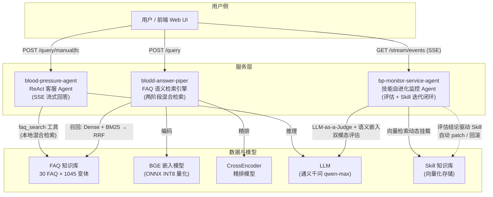

# 平台总体架构

> 血压计 AI 客服平台：三个独立微服务组成"检索 → 问答 → 自进化"闭环。

## 1. 系统全景



三个服务**独立部署、独立演进**（各自仓库、各自 CI），通过统一工程基建保持同款口径。

## 2. 各系统职责

| 系统 | 定位 | 核心技术 | 关键指标 |
|---|---|---|---|
| [blodd-answer-piper](https://github.com/zhou06080120/blodd-answer-piper) | FAQ 语义检索引擎 | Dense(BGE)+BM25 双路召回 → RRF 融合 → CrossEncoder 精排；ONNX INT8 量化 | Top1 94.91% / Top3 98.61%；p50 延迟 34.7→16.5ms（2.28×） |
| [blood-pressure-agent](https://github.com/zhou06080120/blood-pressure-agent) | 面向用户的 ReAct 客服 Agent | 手写 ReAct 与 Function Calling 双实现、SSE 流式、5 异构工具、语义缓存、决策状态机护栏 | 203 单测 / 覆盖率 87%；BM25 门禁 Top1 94.1% |
| [bp-monitor-service-agent](https://github.com/zhou06080120/bp-monitor-service-agent) | 技能自进化监控 Agent | LLM-as-a-Judge + 语义嵌入双模态评估、Skill 向量检索动态挂载、异步任务解耦 + SSE 进度 | 评估器判别力门禁双 100%（好答放行/坏答拦截） |

## 3. 服务间关系

当前为**松耦合三服务**（可独立运行）：

1. **用户问答主链路**：用户 → `blood-pressure-agent`（ReAct 循环：思考 → 工具调用 → 观察 → 收敛作答），`faq_search` 工具内置与 blodd 同款的混合检索逻辑（BM25 + 语义向量 + RRF），SSE 逐步推送思考过程；
2. **检索兜底链路**：轻量客户端 / 标注员可直接调 `blodd-answer-piper` 的 `/query`，两阶段检索返回 Top-K 候选与置信度，低于阈值（0.82）自动拦截并建议就医；
3. **质量闭环链路**：`bp-monitor-service-agent` 周期性拉取会话样本，用 LLM-as-a-Judge + 语义嵌入双模态校验回答质量，评估结论驱动 Skill 自动 patch / 回滚（带快照精确回退），前端经 SSE 实时观察迭代进度。

## 4. 三仓同款工程基建

| 基建模块 | 作用 | 引入阶段 |
|---|---|---|
| `src/rate_limit.py` | 按 IP 滑动窗口限流（零依赖，/health /metrics 豁免） | P1 |
| `src/observability.py` | JSON 结构化日志 + request_id 贯穿 + Prometheus /metrics + LLM 调用埋点 | P2 |
| `src/compliance.py` | 医疗免责声明 + 输入校验 + Prompt 注入拦截 | P3 |
| `evals/gate.py` | CI 评估门禁：检索命中率 / 评估器判别力回归即拦截 | P2 |
| CI（GitHub Actions） | lint → test(3.10/3.12) → eval-gate → docker，五 job 全绿才放行 | P0-P2 |

## 5. 部署拓扑

```
docker compose up --build   # 本仓库 docker-compose.yml

宿主机端口          服务
8001  ──────────►  bp-monitor-service-agent   (SSE 进度流 + 评估任务)
8002  ──────────►  blood-pressure-agent       (SSE 问答流)
8003  ──────────►  blodd-answer-piper         (同步 JSON 检索)
```

- 三个镜像均由各自仓库 Dockerfile 多阶段构建（依赖层 + 运行层分离，模型权重运行时挂载不入镜像）；
- 密钥统一走环境变量注入（`.env`，见 `.env.example`），代码与镜像零硬编码；
- 每个服务自带 `/health`（探针豁免限流）与 `/metrics`（Prometheus 抓取，Grafana 可直接对接）。

## 6. 医疗合规设计

- **免责声明**：三个服务的对外响应统一附带 `MEDICAL_DISCLAIMER`（仅供健康教育参考，不替代执业医师诊疗），前端页脚同步展示；
- **低置信拦截**：检索置信度低于阈值时不编造答案，改为固定兜底话术 + 就医建议；
- **输入安全**：长度上限（500 字）+ 空输入拒绝 + 控制字符剥离；LLM 生成链路叠加 Prompt 注入模式拦截（指令覆盖 / 角色劫持 / 系统提示探测）；
- **角色边界**：拒绝"扮演医生"类角色劫持——AI 始终以"健康教育参考"定位作答。
